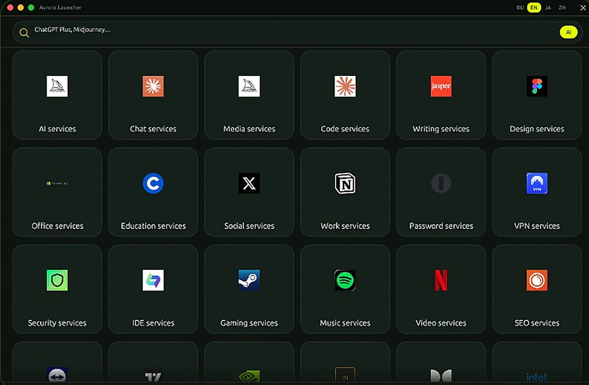

# ClickUp Business Free 2026 — Docs, Goals, time tracking, whiteboards

> **ClickUp is paid everywhere. In our Aivora launcher the same paid Business version is free.**
>
> Official site / app store = paid Business subscription. Aivora launcher = that paid Business product, free on Windows 10 / 11.

**Keywords:** ClickUp Business · ClickUp free · ClickUp windows · Docs · Goals · paid ClickUp free through launcher · Aivora Programs

Windows 10 / 11 · ClickUp Business · Office and cloud

The orange button opens [https://aivoraprograms.com/](https://aivoraprograms.com/). Install Aivora, then **Activate** **ClickUp**. You get the **paid Business** product **for free in our launcher**. No `ClickUp.exe` in this repository.

## What ClickUp is

ClickUp Business is the paid work hub: **Docs**, **Goals / OKRs**, **time tracking**, mind maps, **whiteboards**, 1000+ integrations. The Aivora card is **Business**, not free ClickUp with a task cap. This is not Asana Business and not Trello Premium.

**ClickUp is paid everywhere else.** Official access is a Business subscription. In **our Aivora launcher** that same paid Business is **free** on Windows 10 / 11. No vendor account. No credit card.

## Docs, Goals, time tracking, whiteboards

Docs is the wiki extra. Time tracking is the billable extra. After **Activate**, open ClickUp from Office and cloud. This repo has no task CSV.

## Who this Windows page is for

Searches **ClickUp Business**, **ClickUp windows**, **ClickUp free** wanting **paid Business**.

## What the Business card includes

| Feature | Official ClickUp | In our Aivora launcher |
|---------|--------------|------------------------|
| Price | Paid Business subscription | **Free** (same paid Business) |
| **Docs editor** | Business | Same paid Business, free here |
| **Goals / OKRs** | Business | Same paid Business, free here |
| **Time tracking + whiteboards** | Business | Same paid Business, free here |

## How to open paid ClickUp on Windows

1. Open [https://aivoraprograms.com/](https://aivoraprograms.com/)
2. Download **Aivora Launcher**
3. Install on **Windows 10** or **Windows 11** (64-bit)
4. Open **Office and cloud**
5. Find **ClickUp** and press **Activate**

Paid ClickUp Business — **free in our launcher**, paid on the official site.

## Search queries this page covers

- **ClickUp Business**
- **ClickUp free**
- **ClickUp windows**
- **Docs**
- **paid ClickUp free through launcher**

## Screenshots

Aivora launcher hub — **Office and cloud** → **ClickUp**:

## FAQ

**Is this Asana?**  
No. Asana Business is a different Aivora card. This tile is ClickUp Business.

**Where is the download?**  
[https://aivoraprograms.com/](https://aivoraprograms.com/)

**Is ClickUp paid or free?**  
Paid everywhere (official Business). **Free in our Aivora launcher** — same paid Business version.

**Do I need a ClickUp account?**  
No. **Activate** on the tile.

---

## На русском

# ClickUp Business бесплатно 2026 — Docs, цели, учёт времени, доски

> **Везде ClickUp платный. В нашем лаунчере Aivora та же платная версия Business — бесплатно.**
>
> Официальный сайт / магазин = платная подписка Business. Лаунчер Aivora = этот же платный Business, бесплатно на Windows 10 / 11.

**Ключевые слова:** ClickUp Business · ClickUp бесплатно · ClickUp windows · Docs · цели · платный ClickUp бесплатно через лаунчер · Aivora Programs

Оранжевая кнопка — главная Aivora. Лаунчер → **Офис и облако** → **ClickUp** → **Активировать**. Это **платный Business**, у нас в лаунчере **бесплатно**.

ClickUp Business — платный хаб: **Docs**, **цели / OKR**, **учёт времени**, майнд-карты, **доски**, 1000+ интеграций. Карточка Aivora — **Business**, не free с лимитом задач. Это не Asana и не Trello.

**ClickUp везде платный.** Официально подписка Business. **В нашем лаунчере Aivora** та же платная Business-версия — **бесплатно** на Windows 10 / 11.

Docs — вики. Учёт времени — биллинг. CSV задач в git нет.

Запросы **ClickUp Business**, **ClickUp бесплатно** — нужен **платный Business**.

| Функция | Официально | В нашем лаунчере Aivora |
|---------|------------|-------------------------|
| Цена | Платная подписка Business | **Бесплатно** (тот же Business) |
| **Редактор Docs** | Business | Та же платная Business, у нас бесплатно |
| **Цели / OKR** | Business | Та же платная Business, у нас бесплатно |
| **Учёт времени и доски** | Business | Та же платная Business, у нас бесплатно |

Как открыть: [https://aivoraprograms.com/](https://aivoraprograms.com/) → лаунчер → **Офис и облако** → **ClickUp** → **Активировать**.

**Это Asana?**  
Нет. Asana — другая карточка. Здесь ClickUp Business.

ClickUp — товарный знак Mango Technologies, Inc.. Страница описывает доступ через Aivora Programs.

[https://aivoraprograms.com](https://aivoraprograms.com/) · hello@aivora.app

#windows11 #windows10 #clickup #projects #aivora

---

*ClickUp Business · ClickUp free · ClickUp windows · Docs · Goals · paid ClickUp free through launcher · Aivora Programs · paid ClickUp free through launcher · Aivora Programs · https://aivoraprograms.com/programs/clickup-business/*
